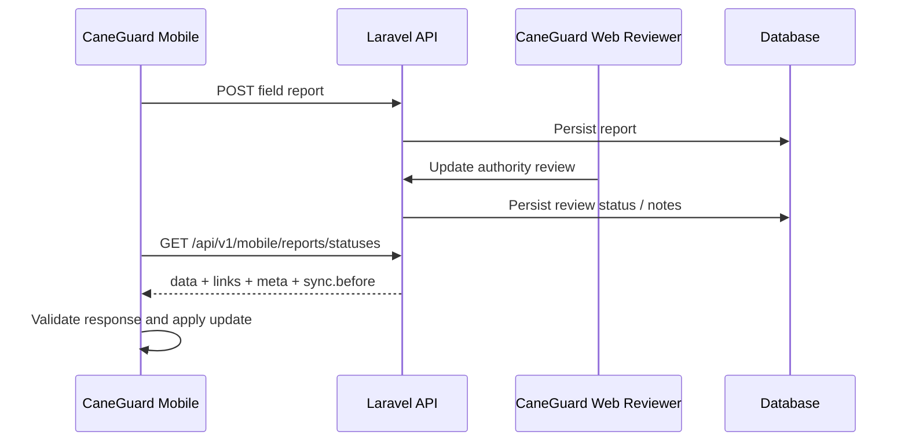

# P0A — Canonical Mobile ↔ API Authority Review Contract

> **Planning baseline (inspected 2026-08-19)**
>
> - `niks0501/caneguard-mobile` `main` @ `3ff11246cbae96b0333f7d2ea6011a05b2a6b8e3`
> - `niks0501/caneguard-web` `main` @ `b4c803db9716a793578c32272ab27dde4f70c590`
>
> Before editing, fetch/pull the current target branch and re-inspect the named files. If either repository head has moved, preserve the intent of this plan but adapt to the new code instead of force-applying old line-level assumptions.


## Objective

Make the authority-review return path deterministic: a report reviewed on CaneGuard Web must be returned by Laravel in one documented wire format and parsed by CaneGuard Mobile without shape drift.

This is a **P0 integration defect** because both repositories can pass isolated tests while disagreeing at runtime. The current Laravel controller returns the synchronization checkpoint as `sync.before`, while the current mobile parser reads `meta.sync_before` or root `sync_before`. The backend feature tests already exercise `sync.before`, so the safest direction is to keep the existing backend response as canonical and correct the mobile consumer.

## User stories

**Field reporter:** As a field reporter, I want the authority review status and feedback for my submitted report to appear on my phone so I know whether staff has reviewed or escalated the case.

**Developer:** As a developer, I want one explicit versioned integration contract and regression fixture so the mobile client and Laravel API cannot silently define different response shapes.

## Current verified code context

### CaneGuard Web / API

Primary producer:

- `api/app/Http/Controllers/Api/V1/MobileReportStatusController.php`
- `api/app/Http/Resources/ReportStatusResource.php`
- `api/tests/Feature/MobileReportStatusTest.php`
- `api/app/Http/Requests/ReportStatusesRequest.php` if query validation needs inspection

The controller currently adds:

```json
{
  "sync": {
    "before": "ISO-8601 timestamp"
  }
}
```

The backend tests already assert `sync.before`, stable checkpoint pagination, ownership scope, authentication/authorization, and the current five review status values. Preserve those protections.

### CaneGuard Mobile

Primary consumer:

- `src/features/reports/api/mobileReportStatusesApi.ts`
- its existing test file under the same feature/test area
- `src/features/reports/services/refreshAuthorityReviewStatus.ts` or the current service that applies received updates
- `src/features/reports/domain/reportReviewTypes.ts`

Current parser logic conceptually does:

```ts
const meta = isRecord(body.meta) ? body.meta : null;
const rawSyncBefore = meta?.sync_before ?? body.sync_before;
```

That is incompatible with the backend's canonical `body.sync.before`.

## Target contract

The API contract remains version 1 and should be documented as:

```json
{
  "data": [
    {
      "uuid": "remote-report-uuid",
      "client_uuid": "mobile-client-uuid",
      "reference_code": "CG-...",
      "review_status": "for_field_validation",
      "review_notes": "Optional authority feedback",
      "reviewed_at": "2026-08-19T10:00:00.000000Z",
      "updated_at": "2026-08-19T10:00:00.000000Z"
    }
  ],
  "links": {
    "next": null
  },
  "meta": {},
  "sync": {
    "before": "2026-08-19T10:00:05.000000Z"
  }
}
```

`sync.before` is the canonical checkpoint. `links.next` may contain `sync_before` as a query parameter for pagination; that does not change the response-field contract.

## Design decision

Do **not** change Laravel to match the buggy mobile mock. Laravel is already internally consistent with its feature tests and checkpoint pagination behavior. Fix the mobile parser and strengthen cross-repository contract evidence.

Do **not** introduce a generated OpenAPI SDK just for this P0. The practical best-practice level for the current capstone is:

- documented wire contract;
- backend feature test for the producer;
- mobile fixture using the exact backend shape;
- malformed-response tests;
- full-system acceptance in P0F.

If the project later adopts OpenAPI for broader API documentation, this endpoint can be migrated then.

## Contract flow



## Implementation phases

### Phase 1 — Reproduce before patching

Use the real Laravel test environment or development API and capture the response from:

```text
GET /api/v1/mobile/reports/statuses
```

Confirm that the current response contains `sync.before`. Then run the current mobile parser test against an object with that exact shape. The expected pre-fix result is `MALFORMED_RESPONSE`.

Record this as the proof that P0A exists on the current branch.

### Phase 2 — Add contract documentation and canonical examples

In `caneguard-web`, create a lightweight contract document such as:

```text
docs/contracts/mobile-report-status-v1.md
```

Document:

- endpoint and authentication role;
- query parameters: `updated_after`, `sync_before`, `per_page`, cursor behavior;
- response fields;
- canonical checkpoint field `sync.before`;
- five supported review status strings as defined by the current model;
- nullability of `reference_code`, `review_notes`, `reviewed_at`;
- pagination rule: all pages in one feed traversal must retain the same checkpoint;
- privacy rule: reviewer private identity is not returned to mobile.

Optionally keep a sanitized example JSON under:

```text
docs/contracts/examples/mobile-report-status-v1.json
```

Do not introduce a runtime dependency on the docs file.

### Phase 3 — Correct the mobile parser

In `mobileReportStatusesApi.ts`:

1. Validate that `body.sync` is an object.
2. Read `body.sync.before`.
3. Validate the checkpoint with the existing timestamp validator.
4. Preserve the current origin-boundary protection for `links.next`.
5. Preserve duplicate identity detection.
6. Preserve stable-checkpoint verification across pages.

A practical compatibility strategy is allowed for one transition:

```text
canonical: body.sync.before
legacy fallback: meta.sync_before or body.sync_before
```

If a canonical value exists, it wins. If both canonical and legacy values exist and conflict, treat the response as malformed rather than silently choosing one. The contract document must still name only `sync.before` as canonical.

If there is no known deployed server returning the legacy shape, prefer deleting the fallback and keeping the parser strict.

### Phase 4 — Replace misleading mobile mocks

Update the mobile tests so at least one fixture is shaped exactly like the Laravel feature-test response. Name it clearly, for example:

```text
test/fixtures/laravel-mobile-report-status-v1.ts
```

or keep it next to the test if that matches repository conventions.

The fixture should contain:

- `data`;
- `links`;
- `meta`;
- `sync.before`;
- one status item with realistic null and non-null cases.

Do not keep `meta.sync_before` as the happy-path mock.

### Phase 5 — Strengthen malformed-response coverage

Mobile tests should cover:

- valid `sync.before`;
- missing `sync`;
- missing `sync.before`;
- invalid checkpoint timestamp;
- canonical/legacy conflict if compatibility fallback is implemented;
- checkpoint changes between pages;
- duplicate `client_uuid`;
- duplicate remote `uuid`;
- non-string `links.next`;
- foreign-origin continuation URL;
- unsupported/malformed status item fields;
- overlong review feedback;
- 401 → `AUTH_REQUIRED`;
- 403/404 capability behavior as currently designed.

Laravel tests should continue to cover:

- authentication;
- owner scoping;
- authorization ability;
- stable pagination checkpoint;
- exact current serializer fields;
- no reviewer private identity leakage.

### Phase 6 — Verify the status is applied, not merely parsed

Add or update a service-level mobile test for the layer that applies `AuthorityReviewStatusUpdate` to the local report. Prove that:

- matching `client_uuid`/remote identity updates the correct report;
- stale status updates do not overwrite a newer local authority status if the existing code has freshness protection;
- review notes and timestamps are stored as intended;
- the feed checkpoint is only advanced after a successful feed application.

Do not broaden this task into review UX redesign.

## Likely files to modify

### `caneguard-mobile`

Existing:

- `src/features/reports/api/mobileReportStatusesApi.ts`
- current tests for `mobileReportStatusesApi`
- authority-review refresh/application service tests if needed

Possible new:

- a sanitized Laravel-shaped status fixture

### `caneguard-web`

Existing:

- `api/tests/Feature/MobileReportStatusTest.php` only if a stronger exact-contract assertion is needed

New:

- `docs/contracts/mobile-report-status-v1.md`
- optional `docs/contracts/examples/mobile-report-status-v1.json`

The controller itself should not need a wire-format change unless reproduction shows that current main differs from the inspected baseline.

## Automated verification

### Mobile

Run at minimum:

```bash
npm run typecheck
npm run lint
npm test -- mobileReportStatusesApi
```

Then the full suite:

```bash
npm test
```

If the repository's Jest pattern requires a different test selector, use the existing convention.

### Web / API

From `caneguard-web`:

```bash
npm run api:test
npm run api:format:check
```

Narrow Laravel test during development:

```bash
cd api
php artisan test --filter=MobileReportStatusTest
```

Finish with:

```bash
npm run check:api
```

## Acceptance criteria

P0A is complete when all of the following are true:

- [ ] The real Laravel response has been verified before editing.
- [ ] `sync.before` is documented as canonical.
- [ ] Mobile parses a fixture with the exact Laravel response shape.
- [ ] Existing pagination/origin/duplicate protections remain intact.
- [ ] Backend feature tests still pass.
- [ ] Mobile parser/service tests pass.
- [ ] A web review can be fetched and applied to the originating mobile report in the P0F integration run.
- [ ] No reviewer-private identity is exposed to the mobile status feed.
- [ ] No unrelated API version or authentication redesign was introduced.

## Rollback / risk control

This should be a low-risk consumer-side correction. If a compatibility fallback is added, keep it isolated in one parsing helper so it can be removed later. Do not alter persisted report data or perform a database migration for P0A.

## Suggested commit shape

`caneguard-mobile`:

```text
fix(reports): parse canonical authority status checkpoint
test(reports): cover Laravel status response contract
```

`caneguard-web`:

```text
docs(api): document mobile report status v1 contract
```

Only add a backend code commit if reproduction proves a backend defect.

## Senior execution rules

Treat this as a stabilization task, not a redesign. The agent should first prove the problem on the current branch, then make the smallest coherent production change that fixes the root cause, then add regression coverage. Do not silently change product scope, disease classes, report semantics, authentication roles, or database meaning.

Before editing:

1. Confirm the worktree is clean and note the current commit.
2. Read repository-local instructions such as `PROJECT_CONTEXT.md`, `AGENTS.md`, README development notes, and existing test conventions if present.
3. Run the narrow baseline tests for the affected area before changing code.
4. Inspect the production code and its existing tests together. Do not trust an existing mock if it contradicts the producer on the other repository.
5. Keep changes atomic. Do not mix unrelated UI polish or refactors into a P0 stabilization commit.
6. Prefer existing dependencies and patterns. Add a dependency only if the task cannot be solved safely with the current stack.
7. Never commit credentials, MapTiler keys, tokens, local IP addresses, `.env.local`, database dumps, or real participant/farmer data.
8. If implementation reveals that the verified finding no longer exists, stop and document the evidence instead of manufacturing a change.

At completion, provide a short handoff containing: files changed, behavior changed, tests run, test results, manual verification still required, and any residual risk.


## Definition of done

A reviewer changes a report on the web, Laravel returns the update under the documented contract, mobile parses it without ambiguity, and the correct local report reflects the updated authority state.
