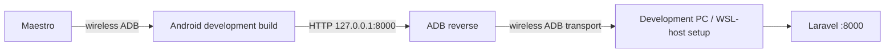

# P0B — Reliable Physical-Device API Connectivity and API Reachability

> **Planning baseline (inspected 2026-08-19)**
>
> - `niks0501/caneguard-mobile` `main` @ `3ff11246cbae96b0333f7d2ea6011a05b2a6b8e3`
> - `niks0501/caneguard-web` `main` @ `b4c803db9716a793578c32272ab27dde4f70c590`
>
> Before editing, fetch/pull the current target branch and re-inspect the named files. If either repository head has moved, preserve the intent of this plan but adapt to the new code instead of force-applying old line-level assumptions.


## Objective

Make development-build testing on a real Android phone predictable while preserving the user's current **wireless ADB / wireless debugging** workflow. CaneGuard must distinguish general network connectivity from actual CaneGuard API reachability.

This is P0 because an app can currently appear "Online" while the Laravel server is unreachable, making synchronization failures difficult to diagnose.

## User stories

**Developer:** As a developer using a physical Android development build with wireless debugging and Maestro, I want one documented API connectivity path so I can reproduce mobile ↔ Laravel integration reliably.

**Field reporter:** As a field reporter, I want CaneGuard to distinguish "network available" from "CaneGuard server unavailable" so I understand why a saved report is not synchronizing.

## Current verified code context

### Mobile

- `.env.example` currently uses `EXPO_PUBLIC_API_BASE_URL=http://127.0.0.1:8000`.
- `src/features/sync/providers/SyncProvider.tsx` derives `isOnline` from NetInfo:
  `isConnected === true && isInternetReachable !== false`.
- That signal represents network/internet reachability, **not** Laravel health.
- Mobile scripts already include Maestro support in `package.json`:
  `e2e`, `e2e:flow`, `e2e:doctor`.

### Web / API

- `caneguard-web` exposes a health endpoint with backend feature coverage.
- `package.json` currently starts the PHP development server at `127.0.0.1:8000` through `npm run api:dev`.
- That loopback binding is compatible with an ADB reverse workflow.

## Important test constraint: wireless debugging

Do **not** automate a test that turns the phone's Wi-Fi off while Maestro is controlling the phone through wireless ADB. The control channel itself depends on Wi-Fi and will disappear.

Actual Wi-Fi-off/on acceptance is intentionally moved to:

```text
MANUAL-WIFI-OFFLINE-RECOVERY-TEST.md
```

P0B automated verification keeps Wi-Fi and wireless ADB connected.

## Supported development connection modes

### Mode A — Primary for the current setup: wireless ADB + ADB reverse

When the phone is already connected through wireless debugging:

```bash
adb devices
adb reverse tcp:8000 tcp:8000
adb reverse --list
```

Mobile config can remain:

```env
EXPO_PUBLIC_API_BASE_URL=http://127.0.0.1:8000
```

Architecture:



This is the preferred normal development path **only after it is verified in the actual WSL/Windows setup**.

### Mode B — Fallback: LAN API URL

If ADB reverse is unreliable in the specific environment, use a LAN address:

```env
EXPO_PUBLIC_API_BASE_URL=http://<DEV_MACHINE_LAN_IP>:8000
```

This requires Laravel to listen on an interface reachable from the phone and the firewall to permit the private-network port. Do not commit the LAN IP. Do not expose the development server publicly.

Do not support several undocumented modes simultaneously. Document which mode is the team default and when the fallback is used.

## Design decision: API health is diagnostic, not a hard gate

Add a lightweight API reachability signal, but **do not make `/api/health` a mandatory prerequisite for every upload**. The actual upload endpoint remains the source of truth.

Why: a health endpoint can be misconfigured independently of a report endpoint. A diagnostic preflight should improve clarity, not create a new single point of failure.

Recommended states:

```ts
type ApiReachability = 'unknown' | 'checking' | 'reachable' | 'unreachable';
```

Keep this separate from:

```ts
isOnline: boolean | null
```

## Target behavior

| Network | Laravel API | UI meaning | Sync behavior |
|---|---|---|---|
| unavailable | unknown/unreachable | Offline | keep finalized reports queued |
| available | unreachable | Network available, CaneGuard server unavailable | preserve queue; retry later/manual |
| available | reachable | Connected to CaneGuard server | sync eligible reports |
| available | auth expired | Server reachable, sign-in required | preserve queue; stop and re-auth |

Avoid presenting all four states as a single "Online/Offline" badge.

## Implementation phases

### Phase 1 — Reproduce the current ambiguity

With wireless ADB connected:

1. Start the development build.
2. Confirm NetInfo shows online.
3. Stop Laravel while leaving Wi-Fi connected.
4. Observe current mobile behavior.
5. Confirm that `isOnline` can remain true even though sync requests fail.

This proves P0B without disconnecting Maestro.

### Phase 2 — Standardize the development connection procedure

Add/update a repo development guide, suggested:

```text
docs/development/physical-android-api.md
```

Include:

```bash
# 1. Start API
npm run api:dev

# 2. Verify API on the host
curl http://127.0.0.1:8000/api/health

# 3. Verify wireless ADB
adb devices

# 4. Establish reverse port
adb reverse tcp:8000 tcp:8000
adb reverse --list

# 5. Start the mobile development build / Metro using the team's normal command
```

If WSL and Windows ADB are split, document the exact working team arrangement found during verification rather than guessing. The implementation agent should record the command sequence that actually works on the developer machine.

### Phase 3 — Add an API health client

Suggested new mobile file, adapted to existing naming:

```text
src/features/shared/api/apiHealth.ts
```

Requirements:

- call the existing public health endpoint;
- use the existing `apiRequest`/base URL abstraction if appropriate;
- use a short timeout, e.g. 3–5 seconds;
- return a small typed result rather than throwing raw errors into UI;
- never include auth tokens if the endpoint is public;
- distinguish timeout/network failure from malformed health payload if the existing endpoint has a defined schema.

Do not add a new third-party networking library.

### Phase 4 — Expose API reachability through the existing sync boundary

Prefer extending the existing sync/provider surface rather than creating a second competing connectivity provider unless current architecture clearly favors separation.

Potential context additions:

```ts
apiReachability
checkApiReachability()
```

Trigger diagnostic checks on:

- authenticated app startup;
- app resume;
- NetInfo transition back to online;
- user-initiated Sync;
- after a sync request fails due to network/server connectivity.

Do not ping every few seconds just to keep a green indicator.

For P0E, a retry timer may attempt the actual sync later; that is separate from the diagnostic health check.

### Phase 5 — Improve the user-facing state

Use concise state language. Example:

```text
Network
Available

CaneGuard server
Connected
```

or:

```text
Network
Available

CaneGuard server
Unavailable
```

If the current home screen only has space for one compact badge, prefer a truthful combined label:

- `Offline`
- `Server unavailable`
- `Connected`

with a more detailed explanation in the sync/status area.

Do not expose `127.0.0.1`, port numbers, tokens, or developer diagnostics to normal production users.

### Phase 6 — Preserve production environment rules

Do not weaken existing production HTTPS validation merely to make local development easier.

Development may use `http://127.0.0.1:8000`; non-development builds should continue following the repository's current secure base-URL rules.

## Likely files to modify

### Mobile existing

- `.env.example`
- `src/config/env.ts`
- `src/features/sync/providers/SyncProvider.tsx`
- `src/features/sync/hooks/useSync.ts`
- home/sync status component that currently displays connectivity
- existing SyncProvider tests

### Mobile possible new

- `src/features/shared/api/apiHealth.ts`
- tests for health/reachability
- `docs/development/physical-android-api.md`

### Web/API

Normally no production change is needed if `/api/health` already works. Only strengthen its test or docs if reproduction shows a gap.

## Automated test plan — Wi-Fi remains ON

Unit/component tests should prove:

- NetInfo online + health success → API reachable;
- NetInfo online + health timeout → API unreachable;
- NetInfo offline → do not mislabel as server-connected;
- a server reachability failure does not delete or finalize a queued report incorrectly;
- health-check failure does not crash the provider;
- session changes do not leak old reachability state into another user.

Maestro/wireless ADB development smoke:

1. Run `npm run e2e:doctor`.
2. Keep Wi-Fi on.
3. Verify app can sign in / reach API with Laravel running.
4. Stop Laravel from the development machine.
5. Verify the app communicates server unavailability while Maestro remains connected.
6. Restart Laravel.
7. Trigger resume/manual sync or the P0E retry path.
8. Verify API connectivity recovers.

Do not toggle Android Wi-Fi in this automated suite.

## Commands

### Mobile

```bash
npm run typecheck
npm run lint
npm test
npm run e2e:doctor
```

Run the narrow SyncProvider/API health tests during iteration, then the full test suite.

### Web/API

```bash
npm run api:test
npm run api:format:check
```

Use the health endpoint feature test as the narrow backend check.

## Acceptance criteria

- [ ] The team has one documented primary physical-device API connection workflow.
- [ ] Wireless ADB + development build remains supported.
- [ ] `EXPO_PUBLIC_API_BASE_URL` behavior is documented for that workflow.
- [ ] ADB reverse is verified rather than assumed.
- [ ] General network connectivity and CaneGuard API reachability are represented separately.
- [ ] Stopping Laravel while Wi-Fi remains on produces a server-unavailable state.
- [ ] Restarting Laravel allows the app to recover without reinstalling the development build.
- [ ] API health is diagnostic and does not become a hard prerequisite that can block a valid upload endpoint.
- [ ] No credentials/local IPs are committed.
- [ ] True Wi-Fi-off/on behavior is tested using the separate manual acceptance document.

## Suggested commit shape

```text
feat(sync): expose CaneGuard API reachability
docs(dev): standardize physical Android API connectivity
test(sync): cover server-unreachable state
```

## Senior execution rules

Treat this as a stabilization task, not a redesign. The agent should first prove the problem on the current branch, then make the smallest coherent production change that fixes the root cause, then add regression coverage. Do not silently change product scope, disease classes, report semantics, authentication roles, or database meaning.

Before editing:

1. Confirm the worktree is clean and note the current commit.
2. Read repository-local instructions such as `PROJECT_CONTEXT.md`, `AGENTS.md`, README development notes, and existing test conventions if present.
3. Run the narrow baseline tests for the affected area before changing code.
4. Inspect the production code and its existing tests together. Do not trust an existing mock if it contradicts the producer on the other repository.
5. Keep changes atomic. Do not mix unrelated UI polish or refactors into a P0 stabilization commit.
6. Prefer existing dependencies and patterns. Add a dependency only if the task cannot be solved safely with the current stack.
7. Never commit credentials, MapTiler keys, tokens, local IP addresses, `.env.local`, database dumps, or real participant/farmer data.
8. If implementation reveals that the verified finding no longer exists, stop and document the evidence instead of manufacturing a change.

At completion, provide a short handoff containing: files changed, behavior changed, tests run, test results, manual verification still required, and any residual risk.


## Definition of done

A physical Android development build using wireless debugging can reliably reach the intended Laravel instance, and the app can truthfully distinguish "network available" from "CaneGuard server reachable."
