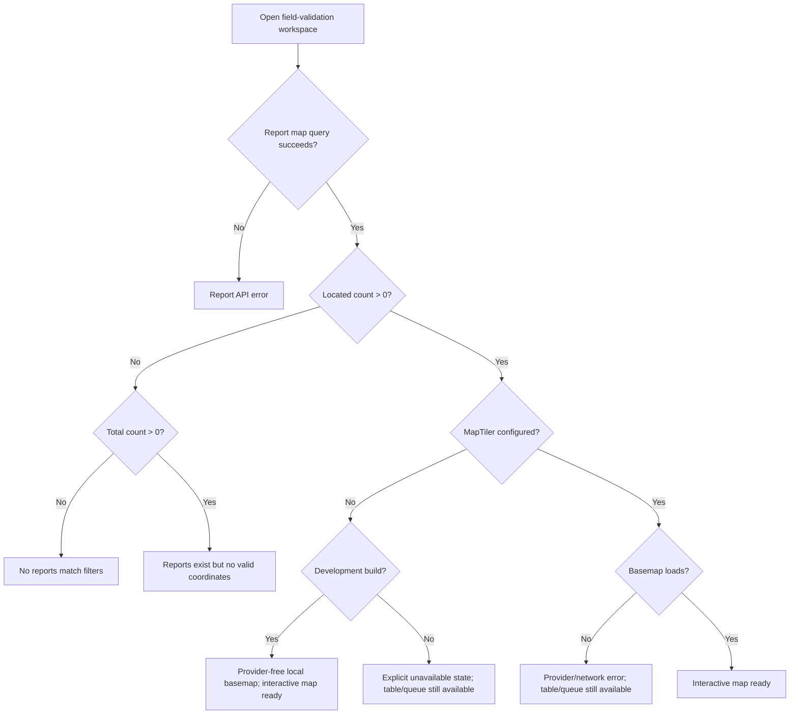

# P0C — Field-Validation Map Reliability and Failure Diagnostics

> **Planning baseline (inspected 2026-08-19)**
>
> - `niks0501/caneguard-mobile` `main` @ `3ff11246cbae96b0333f7d2ea6011a05b2a6b8e3`
> - `niks0501/caneguard-web` `main` @ `b4c803db9716a793578c32272ab27dde4f70c590`
>
> Before editing, fetch/pull the current target branch and re-inspect the named files. If either repository head has moved, preserve the intent of this plan but adapt to the new code instead of force-applying old line-level assumptions.


## Objective

Make the existing CaneGuard Web field-validation map reliable, diagnosable, and resilient without replacing MapLibre/MapTiler or changing the report-location model.

This is P0 because a missing MapTiler key, provider failure, report API failure, zero located reports, or queue failure can all make the map workspace appear broken for different reasons.

## User story

As MAO/SRA-side personnel, I want the field-validation workspace to clearly show whether map data is available, whether reports have coordinates, and whether the basemap provider is working so I can still review field observations even if one map dependency fails.

## Current verified code context

### Configuration

`.env.example` currently includes:

```env
VITE_REPORT_REFRESH_MS=600000
VITE_MAPTILER_KEY=
```

`src/config/env.ts` already parses `mapTilerKey`.

### Map component

Primary:

```text
src/components/fieldValidation/ValidationMap.tsx
```

Current behavior:

- builds a MapTiler style URL when the key is non-empty;
- without a key, development uses a provider-free local basemap, while non-development builds show `Map unavailable`;
- keeps the report-table fallback below the map and shows `Map unavailable` for genuine basemap load failures.

### Workspace page

Primary:

```text
src/pages/FieldValidationMapPage.tsx
```

Current code separately creates map and queue queries, but the main workspace content only renders when both `mapData && queueData` are present. This means one failed side can prevent the other valid side from being useful.

### Query/data layer

- `src/hooks/fieldValidationQueries.ts`
- `src/hooks/useFieldValidation.ts`
- `src/data/api/ApiFieldValidationRepository.ts`
- `src/domain/fieldValidation.types.ts`
- API feature tests under `api/tests/Feature/ReportMapAndQueueTest.php`

The backend intentionally tracks total/located/unlocated data. Preserve that distinction.

## Non-goals

Do not:

- replace MapLibre;
- replace MapTiler during this P0 unless the existing provider is proven unusable;
- add PostGIS;
- add offline web basemap downloads;
- convert missing coordinates into fake coordinates;
- infer barangay centroids as if they were exact report locations;
- hide unlocated reports.

## Failure-state model

The UI should distinguish these states:



These are different causes and should not collapse into one generic empty state.

## Implementation phases

### Phase 1 — Verify configuration before coding

On the actual development machine:

1. Inspect local `.env.local`/environment without printing any key into logs.
2. Note whether `VITE_MAPTILER_KEY` is configured; it is optional for the development fallback.
3. Open the map and inspect the browser network/console.
4. With a key, confirm whether MapTiler style/tile requests are successful; without one, confirm the local fallback makes no hosted resource requests.
5. Call the map API through the normal authenticated web flow and inspect:
   - total count;
   - located count;
   - unlocated count;
   - feature count.

Do not require a MapTiler key for local development; use the provider-free fallback when it is absent.

### Phase 2 — Keep configuration explicit

Keep the key in local/environment configuration; never hard-code it into source.

For non-development builds without a key, improve the existing unavailable state so it says exactly what is wrong:

```text
Map provider is not configured.
The report table and validation queue remain available.
```

A development build without a key uses the provider-free local basemap instead; genuine basemap load failures remain unavailable.

Do not present configuration guidance meant for developers to end users in production if the app has a production error boundary. In development it may mention `VITE_MAPTILER_KEY`; in production prefer neutral language.

### Phase 3 — Add basemap lifecycle state

Inside `ValidationMap.tsx`, track a compact state such as:

```ts
type MapProviderState = 'loading' | 'ready' | 'error';
```

Use the map component's supported lifecycle callbacks to:

- set ready on successful map load;
- set error on provider/style failure;
- keep report/table data visible.

Do not dump raw provider error objects, URLs containing keys, or request details into the user interface.

A development console message may be sanitized if repository conventions allow it.

### Phase 4 — Fit the viewport to actual data

Replace the fixed initial-only experience with data-aware framing:

- zero located points → default Nasugbu view;
- one located point → center on it at a useful local zoom;
- multiple located points → `fitBounds()` with padding and a reasonable `maxZoom`.

**Important UX rule:** do not snap the user's map back on each P0D polling refresh.

Best-practice behavior:

- auto-fit on first successful load for the current filter set;
- auto-fit again when filters materially change;
- preserve the user's manual pan/zoom during background refetch;
- if an entirely new result set appears because filters changed, framing may reset.

Implement this with a `MapRef` and a simple "has fitted for current filter/result context" mechanism rather than a complex global map state store.

### Phase 5 — Make map and queue independent

Refactor `FieldValidationMapPage.tsx` so:

- map success + queue failure → map/table still render, queue shows its own error;
- queue success + map API failure → queue still renders, map area shows its own error;
- map provider failure → API-derived table/coverage and queue remain usable;
- stale cached data can remain visible during refetch errors.

Do not turn one child failure into a full-page failure unless authorization or malformed global state truly blocks the whole workspace.

### Phase 6 — Improve data coverage messaging

Use existing metadata to communicate:

- `N located`;
- `N unlocated`;
- no matching reports;
- reports exist but cannot be plotted due to missing/invalid coordinate pairs.

Never call an unlocated report invalid overall. It may still be a valid report that lacks location.

### Phase 7 — Preserve decision-support language

Keep the current wording that AI results are possible/preliminary results, not staff confirmation. Map marker status is review workflow state, not disease severity.

Do not add a "severity" legend based on affected percentage.

## Likely files to modify

Existing:

- `src/components/fieldValidation/ValidationMap.tsx`
- `src/pages/FieldValidationMapPage.tsx`
- `src/pages/FieldValidationMapPage.test.tsx`
- existing `ValidationMap` tests if present
- CSS for the map status/error overlay if needed

Possibly:

- `src/hooks/useFieldValidation.ts`
- `src/hooks/fieldValidationQueries.ts` only if query-state behavior needs adjustment
- `src/config/env.test.ts` if configuration behavior changes

Backend should not need a change unless Phase 1 proves map metadata is wrong.

## Automated test plan

### Component tests

Cover:

- no MapTiler key in development → provider-free local basemap with interactive map layers;
- no MapTiler key outside development → explicit unavailable state;
- genuine provider error state remains unavailable without hiding report data;
- map data remains represented through table/coverage even without basemap;
- one feature produces a one-point framing call;
- multiple features produce `fitBounds`;
- background data refetch does not continuously reset viewport;
- point click still resolves the correct report popup;
- cluster behavior remains intact.

Map libraries are often difficult in jsdom. Mock only the map boundary needed to assert callbacks/ref operations; do not build a fake MapLibre implementation.

### Page tests

Cover independent state combinations:

- map data success + queue success;
- map error + queue success;
- map success + queue error;
- cached data + refetch error;
- `unlocatedCount > 0`;
- no reports;
- malformed map payload;
- authorization failure.

### Backend

Run existing report map/queue feature tests. Add a regression only if data metadata behavior changes.

## Commands

```bash
npm run test
npm run typecheck
npm run lint
npm run build
```

API:

```bash
npm run api:test
npm run api:format:check
```

Final web gate:

```bash
npm run check:all
```

## Manual development verification

With a valid local MapTiler key:

1. Open `/map`.
2. Confirm basemap loads.
3. Confirm a known located test report appears.
4. Confirm popup opens the correct report.
5. Apply a barangay/date/status filter and confirm viewport frames the filtered data.
6. Pan manually; wait through at least one later P0D refresh and confirm the map does not unexpectedly snap back.
7. Temporarily remove the local MapTiler key and restart Vite; confirm the local basemap, marker/cluster and glyph interactions, and table/queue remain available.
8. Restore the key.

Do not commit the key during this test.

## Acceptance criteria

- [ ] Local MapTiler configuration has been verified before code changes.
- [ ] A missing key outside development is distinguishable from report API failure; development uses the local fallback.
- [ ] Provider load failure is distinguishable from zero located reports.
- [ ] Located/unlocated counts remain truthful.
- [ ] Zero points defaults to a Nasugbu-oriented view.
- [ ] One point centers sensibly.
- [ ] Multiple points fit within the viewport.
- [ ] Polling does not repeatedly reset user pan/zoom.
- [ ] Map and queue can render/fail independently.
- [ ] Report table remains usable if the basemap is unavailable.
- [ ] No fake coordinates are created.
- [ ] Existing map/queue/backend tests and full web checks pass.

## Suggested commit shape

```text
fix(map): expose basemap and data failure states
feat(map): fit field-validation viewport to report data
test(map): cover independent map and queue failures
```

## Senior execution rules

Treat this as a stabilization task, not a redesign. The agent should first prove the problem on the current branch, then make the smallest coherent production change that fixes the root cause, then add regression coverage. Do not silently change product scope, disease classes, report semantics, authentication roles, or database meaning.

Before editing:

1. Confirm the worktree is clean and note the current commit.
2. Read repository-local instructions such as `PROJECT_CONTEXT.md`, `AGENTS.md`, README development notes, and existing test conventions if present.
3. Run the narrow baseline tests for the affected area before changing code.
4. Inspect the production code and its existing tests together. Do not trust an existing mock if it contradicts the producer on the other repository.
5. Keep changes atomic. Do not mix unrelated UI polish or refactors into a P0 stabilization commit.
6. Prefer existing dependencies and patterns. Add a dependency only if the task cannot be solved safely with the current stack.
7. Never commit credentials, MapTiler keys, tokens, local IP addresses, `.env.local`, database dumps, or real participant/farmer data.
8. If implementation reveals that the verified finding no longer exists, stop and document the evidence instead of manufacturing a change.

At completion, provide a short handoff containing: files changed, behavior changed, tests run, test results, manual verification still required, and any residual risk.


## Definition of done

The user can tell whether the field-validation map is unconfigured, provider-unreachable, data-empty, coordinate-empty, or successfully loaded, while still retaining access to report/queue information when the basemap fails.
