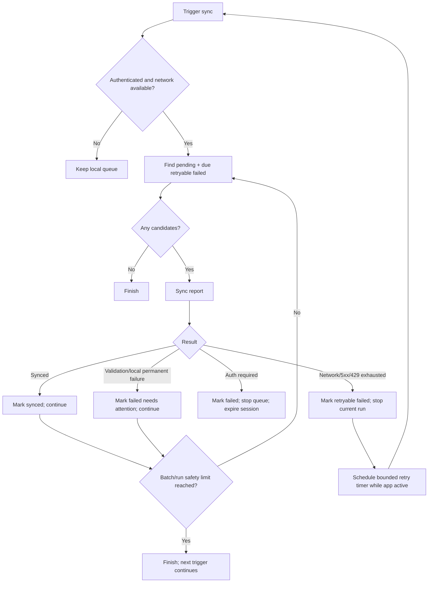

# P0E — Resilient Offline Synchronization, Retry Policy, and Queue Draining

> **Planning baseline (inspected 2026-08-19)**
>
> - `niks0501/caneguard-mobile` `main` @ `3ff11246cbae96b0333f7d2ea6011a05b2a6b8e3`
> - `niks0501/caneguard-web` `main` @ `b4c803db9716a793578c32272ab27dde4f70c590`
>
> Before editing, fetch/pull the current target branch and re-inspect the named files. If either repository head has moved, preserve the intent of this plan but adapt to the new code instead of force-applying old line-level assumptions.


## Objective

Ensure temporary connectivity/server failures delay synchronization rather than permanently stranding valid finalized reports. Keep the current local report model and synchronization statuses; improve **eligibility, retry scheduling, stop conditions, and queue draining**.

This P0 directly supports CaneGuard's offline-first field-report workflow.

## User story

As a field reporter working with weak or intermittent connectivity, I want finalized reports to remain safe on the device and retry automatically when temporary failures recover, without repeatedly retrying reports that require my correction.

## Current verified code context

### Batch runner

`src/features/sync/services/syncPendingFieldReports.ts`

Current behavior:

- trigger sources: `after-save`, `startup`, `resume`, `network-restored`, `manual`;
- default batch limit: `10`;
- only one batch is processed per invocation;
- automatic sources call `findSyncCandidates(limit, false)`;
- `manual` includes failed reports;
- auth failure stops the current batch.

### Repository

`src/features/reports/data/fieldReportSyncRepository.ts`

Current behavior:

- `findSyncCandidates(limit, includeFailed?)`;
- automatic mode selects only `pending`;
- manual mode can select `pending` + `failed`;
- database already stores:
  - `syncStatus`;
  - `lastSyncErrorCode`;
  - `lastSyncAttemptAt`;
  - `syncAttemptCount`;
  - `lastSyncedAt`;
  - remote ID.

### Per-report sync

`src/features/sync/services/syncFieldReport.ts`

Current behavior already has useful immediate retry delays:

```text
2s -> 5s -> 15s
```

for `SyncError.retryable === true`, capped by rate-limit retry-after logic.

After retries are exhausted, the record is marked `failed`.

### Error model

`src/features/sync/errors/syncErrors.ts`

Current codes include:

- `AUTH_REQUIRED`;
- `NETWORK_UNAVAILABLE`;
- `NETWORK_REQUEST_FAILED`;
- `API_VALIDATION_FAILED`;
- `API_FORBIDDEN`;
- `API_RATE_LIMITED`;
- `IMAGE_MISSING`;
- `INVALID_LOCAL_RECORD`;
- `SERVER_ERROR`;
- `UNKNOWN_SYNC_ERROR`.

The in-memory `SyncError` already has a `retryable` flag. After persistence, only the error code remains, so P0E needs a single code-based retry policy.

### Provider

`src/features/sync/providers/SyncProvider.tsx`

Current automatic triggers include startup, resume, and NetInfo `false -> true`. If Wi-Fi stays online while Laravel is down and later comes back, NetInfo may never transition, so a retryable failed report can remain waiting unless another trigger occurs.

## Design decisions

### 1. Keep current sync statuses

Do not add a migration just to create `retry_pending` or `failed_requires_user`.

Keep:

```text
pending
syncing
synced
failed
```

Interpret `failed` using `lastSyncErrorCode`.

### 2. Create one persisted retry policy

Add a single helper:

```ts
isAutoRetryableSyncErrorCode(code)
```

Suggested automatic-retry set:

```text
NETWORK_UNAVAILABLE
NETWORK_REQUEST_FAILED
API_RATE_LIMITED
SERVER_ERROR
```

Suggested user/action set:

```text
API_VALIDATION_FAILED
API_FORBIDDEN
IMAGE_MISSING
INVALID_LOCAL_RECORD
UNKNOWN_SYNC_ERROR
```

`AUTH_REQUIRED` is a session-level blocker: preserve reports, stop the run, require sign-in.

If reproduction shows a code is produced differently, update the classification deliberately and test it.

### 3. General "Sync now" should not bulk-hammer permanent failures

A general queue sync should process:

- pending reports;
- retryable failed reports that are due.

An **individual explicit retry** may convert a selected failed report back to pending after the user has corrected/confirmed it.

This is safer than `manual = retry every failed row`.

### 4. Keep immediate retries and add cross-run cooldown

Retain the existing short per-request retry sequence.

After a report has exhausted those retries and is persisted as failed, prevent lifecycle triggers from immediately starting the whole retry sequence again.

For the current capstone, prefer a simple fixed cross-run minimum cooldown (for example 60 seconds) using `lastSyncAttemptAt` rather than a new database column. Existing short retries already provide exponential-ish backoff within one attempt.

If the implementation cannot enforce a cooldown correctly with the current repository/query structure, a small `nextSyncAttemptAt` migration is acceptable **only after documenting why current fields are insufficient**. Do not start with a migration.

### 5. Drain the queue in bounded batches

Process more than one 10-item batch while conditions are healthy, but enforce safety limits.

Recommended:

- batch size: existing 10;
- maximum automatic run: 50 reports or 5 batches;
- stop when no eligible candidates remain;
- stop on auth failure;
- stop on global transient/server failure likely to affect all following requests;
- continue past one permanent data error so one bad report does not block valid reports.

## Sync decision flow



## Implementation phases

### Phase 1 — Reproduce the stranded-report behavior

Keep Wi-Fi ON and wireless ADB connected.

1. Create/finalize a valid report.
2. Stop Laravel or point the existing dev API to an unavailable server state.
3. Trigger sync and allow current retries to exhaust.
4. Confirm record becomes `failed`.
5. Restart Laravel without changing phone network state.
6. Observe whether the report automatically retries.

This reproduces the "server recovers but NetInfo never changed" case without breaking Maestro.

Actual phone Wi-Fi-off/on acceptance is in the separate manual document.

### Phase 2 — Centralize error-code retryability

In `syncErrors.ts` add:

```ts
export const AUTO_RETRYABLE_SYNC_ERROR_CODES = [...]
export function isAutoRetryableSyncErrorCode(...)
```

The helper should accept the persisted string safely.

Do not duplicate retryable-code lists in repository, provider, and UI.

Also add a user-display classification helper only if needed; do not merge technical retry policy with translated UI strings.

### Phase 3 — Refactor candidate selection away from a boolean flag

The current `includeFailed?: boolean` is ambiguous.

Prefer an explicit API such as:

```ts
findSyncCandidates(limit, {
  includeRetryableFailed: true,
  failedBefore: cutoff
})
```

or:

```ts
findSyncCandidates(limit, 'automatic')
```

with the policy injected/shared in a clear way.

The candidate set for automatic/general sync should be:

```text
finalized
AND same submitter
AND (
  syncStatus = pending
  OR (
    syncStatus = failed
    AND lastSyncErrorCode is auto-retryable
    AND retry cooldown is satisfied
  )
)
```

Preserve oldest-first ordering.

For an explicit per-report retry, keep the current ownership check and `markFieldReportPending()` behavior.

### Phase 4 — Add bounded queue drain

Refactor `executeBatch` into a bounded drain loop or add a higher-level drain around the current batch function.

Requirements:

- no concurrent duplicate runs for the same submitter/session;
- preserve the existing `WeakMap` run serialization;
- gather a meaningful aggregate result;
- maximum reports per run;
- no infinite loop if a candidate keeps reappearing;
- no retry of a just-failed permanent record in the same drain;
- successful reports continue after a single permanent validation/local failure.

Suggested result additions if useful:

```ts
haltReason:
  | 'empty'
  | 'auth-required'
  | 'transient-blocker'
  | 'run-limit'
  | null
```

Do not add fields unless they improve provider behavior/tests.

### Phase 5 — Stop intelligently on global transient failure

If one report exhausts retries with:

- `NETWORK_REQUEST_FAILED`;
- `NETWORK_UNAVAILABLE`;
- `SERVER_ERROR`;
- `API_RATE_LIMITED`;

stop the current queue run. Continuing through the remaining 49 reports is likely to hammer the same unavailable service.

If one report fails with:

- validation;
- missing image;
- invalid local record;

mark it failed/needs attention and continue to the next eligible report.

### Phase 6 — Schedule an app-active retry for transient failures

Because server recovery can occur without NetInfo changing, `SyncProvider` should schedule one bounded retry after a transient-blocker result.

Practical policy:

- one timer per active session/provider;
- delay at least the cross-run cooldown (e.g. 60 seconds);
- clear timer on unmount/logout/session change;
- do not schedule if there are no retryable failures;
- do not schedule if offline;
- do not schedule after auth-required/permanent-only failures;
- if a later manual/startup/resume sync succeeds, clear/reset the pending timer as appropriate.

Add a new trigger source only if useful for observability:

```text
retry-timer
```

This is preferable to constantly polling `/api/health`; it attempts the real operation that matters.

### Phase 7 — Improve queue messaging

Where current UI displays generic "need attention", distinguish at least:

- `Waiting to sync`;
- `Will retry automatically`;
- `Needs attention`;
- `Sign in required`;
- `Synced`.

Do not expose technical error codes directly unless in a developer/debug screen.

### Phase 8 — Preserve idempotency

Queue draining and retries increase the number of possible duplicate requests. The API's existing `client_uuid`/idempotency behavior must remain the safety net.

P0E should not generate a new client UUID on retry.

## Likely files to modify

Existing:

- `src/features/sync/errors/syncErrors.ts`
- `src/features/sync/services/syncFieldReport.ts` only if stop/result semantics need a small change
- `src/features/sync/services/syncPendingFieldReports.ts`
- `src/features/reports/data/fieldReportSyncRepository.ts`
- `src/features/sync/providers/SyncProvider.tsx`
- related unit/provider/repository tests
- sync status UI components if messaging changes

No database schema change should be the default solution.

## Automated test matrix — Wi-Fi stays ON

### Error policy

- network request failure → retryable;
- 5xx → retryable;
- 429 → retryable;
- 422 → not automatically retryable;
- 403 → not automatically retryable;
- missing image/local invalid → not automatically retryable;
- 401 → auth blocker.

### Candidate repository

- pending report is eligible;
- retryable failed report is eligible after cooldown;
- retryable failed report is not eligible before cooldown;
- permanent failed report excluded from general sync;
- report belonging to another submitter excluded;
- draft excluded;
- ordering remains oldest-first.

### Drain

- 1 report syncs;
- 11 reports require two batches and all sync;
- 25 reports drain correctly;
- run safety cap stops a very large queue at the configured maximum;
- one 422 does not block later valid records;
- first exhausted network/5xx/429 failure stops remaining queue for that run;
- auth failure stops queue and marks session required;
- concurrent trigger calls remain serialized/deduplicated;
- existing already-synced behavior remains idempotent.

### Provider retry timer

Use fake timers:

- transient-blocker result schedules one retry;
- permanent-only failures do not schedule;
- logout clears timer;
- unmount clears timer;
- manual successful sync prevents duplicate unnecessary timer work;
- app resume/startup still works.

### API unavailable / recovery with wireless ADB

Keep Wi-Fi on:

1. Laravel running → baseline sync works.
2. Stop Laravel.
3. Let report fail after retries.
4. Restart Laravel.
5. Advance/wait for retry timer or trigger resume.
6. Verify report synchronizes.

No Wi-Fi radio toggle belongs in this automated plan.

## Commands

```bash
npm run typecheck
npm run lint
npm test
npm run e2e:doctor
```

Run narrow sync tests while iterating, then full Jest.

P0F will run the actual Maestro suite.

## Acceptance criteria

- [ ] Retryable error codes are defined in exactly one policy helper.
- [ ] Permanent/user-action failures are not bulk retried automatically.
- [ ] Explicit per-report retry still works after correction.
- [ ] Retryable failed reports become eligible automatically after cooldown.
- [ ] Existing immediate 2s/5s/15s retry behavior is preserved or deliberately improved with equivalent tests.
- [ ] Server/network transient failure stops the current drain instead of hammering every queued report.
- [ ] One permanent bad report does not block later valid reports.
- [ ] More than 10 reports can drain in one bounded run.
- [ ] A safety maximum prevents an infinite/unbounded drain.
- [ ] Server recovery while Wi-Fi remains connected can trigger a later automatic retry.
- [ ] Auth failure stops safely and preserves queued data.
- [ ] Retry never generates a new client identity for the same report.
- [ ] True Wi-Fi-off/on recovery passes the separate manual acceptance document.
- [ ] Mobile typecheck/lint/tests pass.

## Suggested commit shape

```text
refactor(sync): centralize persisted retry eligibility
fix(sync): auto-retry transient failed reports
feat(sync): drain pending reports in bounded batches
test(sync): cover retry policy and queue recovery
```

## Senior execution rules

Treat this as a stabilization task, not a redesign. The agent should first prove the problem on the current branch, then make the smallest coherent production change that fixes the root cause, then add regression coverage. Do not silently change product scope, disease classes, report semantics, authentication roles, or database meaning.

Before editing:

1. Confirm the worktree is clean and note the current commit.
2. Read repository-local instructions such as `PROJECT_CONTEXT.md`, `AGENTS.md`, README development notes, and existing test conventions if present.
3. Run the narrow baseline tests for the affected area before changing code.
4. Inspect the production code and its existing tests together. Do not trust an existing mock if it contradicts the producer on the other repository.
5. Keep changes atomic. Do not mix unrelated UI polish or refactors into a P0 stabilization commit.
6. Prefer existing dependencies and patterns. Add a dependency only if the task cannot be solved safely with the current stack.
7. Never commit credentials, MapTiler keys, tokens, local IP addresses, `.env.local`, database dumps, or real participant/farmer data.
8. If implementation reveals that the verified finding no longer exists, stop and document the evidence instead of manufacturing a change.

At completion, provide a short handoff containing: files changed, behavior changed, tests run, test results, manual verification still required, and any residual risk.


## Definition of done

Temporary network/server conditions result in a safe queued/retryable report that eventually synchronizes when conditions recover, while reports requiring correction remain visible for user action and are not retried indefinitely.
