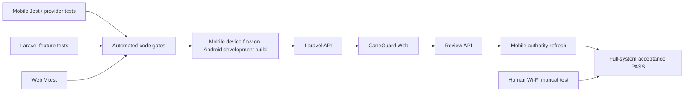

# P0F — Full CaneGuard Cross-System Acceptance and Regression Gate

> **Planning baseline (inspected 2026-08-19)**
>
> - `niks0501/caneguard-mobile` `main` @ `3ff11246cbae96b0333f7d2ea6011a05b2a6b8e3`
> - `niks0501/caneguard-web` `main` @ `b4c803db9716a793578c32272ab27dde4f70c590`
>
> Before editing, fetch/pull the current target branch and re-inspect the named files. If either repository head has moved, preserve the intent of this plan but adapt to the new code instead of force-applying old line-level assumptions.


## Objective

Prove that P0A–P0E work together as one system: Android development build → Laravel API → CaneGuard Web → authority review → Laravel status feed → originating Android record.

P0F is a **release/stabilization gate**, not a new product feature.

> **Current mobile automation:** Mobile device acceptance is owned by the companion [Agent Device guide](https://github.com/niks0501/caneguard-mobile/blob/main/.agent-device/README.md).
>
> This Web repository documents the cross-system boundary here but does not configure or run that mobile tooling.

## User story

As the CaneGuard project team, we want one repeatable acceptance process proving the complete field-report workflow so we can detect integration defects that isolated mobile, API, or web test suites miss.

## Scope

P0F validates:

- authentication;
- local field-report persistence;
- synchronization;
- server persistence/idempotency;
- web freshness;
- field-validation map;
- authority review;
- review-status return path;
- transient API failure recovery;
- queue draining;
- graceful map/provider degradation.

**Actual Wi-Fi OFF/ON tests are excluded from automated device-flow execution because the current device uses wireless ADB.** They are mandatory but live in:

```text
MANUAL-WIFI-OFFLINE-RECOVERY-TEST.md
```

## Test architecture



Use the right tool for each layer. Do not force every scenario into the mobile device flow.

## Why hybrid testing is the best practical approach

The Mobile device flow is strong for Android UI and uses ADB. With wireless debugging, disabling Wi-Fi would destroy the control channel. Laravel/PHPUnit is stronger for API authorization/persistence. Vitest is stronger for React Query and map state behavior.

Adding Playwright, Appium, or a new orchestration framework solely for this P0 would increase maintenance without materially improving capstone evidence. The full-system acceptance run may contain a small operator-assisted web review step if no browser E2E framework already exists.

## Required preconditions

Before P0F starts:

- P0A–P0E merged or checked out together in compatible branches;
- clean test database/environment;
- a dedicated field-reporter test account;
- a dedicated reviewer test account;
- development-only synthetic farmer/report data;
- valid local MapTiler key for the positive map case;
- physical Android development build installed;
- wireless ADB paired and connected;
- the Mobile device preflight passes according to the current companion-repository guide;
- mobile API route verified;
- Laravel health endpoint responds;
- web app points to the same Laravel environment.

Never use real farmer personal data for this acceptance run.

## Baseline automated gates

### Mobile

From `caneguard-mobile`:

```bash
npm run typecheck
npm run lint
npm test
```

Then run the relevant Mobile device suite according to the current companion-repository guide.

The Web/API repository does not duplicate Mobile device-flow commands here.

### Web/API

From `caneguard-web`:

```bash
npm run check:web
npm run check:api
```

Or final combined:

```bash
npm run check:all
```

Do not declare P0F passed if either repository's normal quality gate is red.

## Canonical full-system scenario

### Stage 1 — Start services and prove routing

Verify:

```text
Laravel health -> PASS
Web -> same API -> PASS
Android -> same API -> PASS
Wireless ADB / mobile device flow -> connected
```

Record the repository commits in the acceptance evidence.

### Stage 2 — Authenticate field reporter

On the physical Android development build:

- sign in with the test field-reporter account;
- verify the displayed user/session matches the expected account;
- verify API reachability state is connected.

Expected: authenticated session and no stale prior user's pending count/status.

### Stage 3 — Create a valid local observation/report

Use a synthetic/test image and current supported flow.

Complete all required report fields, including a valid location for the positive map case.

Expected:

- scan/result stored locally;
- field report can be finalized;
- one stable client UUID exists;
- local record survives navigation/app lifecycle.

Do not judge model scientific accuracy in P0F; this is integration testing.

### Stage 4 — Synchronize

Keep Wi-Fi ON for the automated/agent-run scenario.

Expected:

- finalized report enters pending/sync flow;
- upload succeeds;
- local state becomes synced;
- remote UUID/reference code is stored;
- Laravel has exactly one report for that client UUID.

If the same request is repeated because of retry, the server must not create duplicates.

### Stage 5 — Verify web arrival without hard reload

Keep the relevant web view already open before submission if practical.

Expected within `VITE_REPORT_REFRESH_MS` plus reasonable request/render latency:

- report appears in submitted reports;
- dashboard counts update if the report contributes to the displayed metric;
- validation map/queue receives the record according to its review state.

Hard-refreshing the page should not be required for the acceptance criterion.

### Stage 6 — Verify map

For the located report:

- marker appears;
- reference code points to the same report;
- barangay and review state are correct;
- popup/detail navigation opens the same report.

If the map provider is unavailable, this stage is a failure for the positive-map case but report table/queue should remain usable per P0C.

### Stage 7 — Perform authority review

Using the web reviewer account:

- open the report;
- transition it to a valid review state such as `for_field_validation` according to current workflow;
- add a neutral test note if the UI supports review notes;
- save.

Expected immediately:

- report detail reconciles;
- report list updates;
- dashboard updates if affected;
- map/queue cache invalidates and reflects the state.

Do not invent new statuses for the test.

### Stage 8 — Return authority state to mobile

On Android:

- trigger the existing authority-status refresh path through app resume, record refresh, or current designed mechanism;
- observe the status feed.

Expected:

- parser accepts `sync.before`;
- correct local report matches the remote/client identity;
- review status updates;
- authority note/timestamp displays/stores according to existing product behavior;
- unrelated local reports remain unchanged.

This closes the loop:

```text
Mobile -> API -> Web -> API -> Mobile
```

## Required negative/regression scenarios

### A. API server unavailable while Wi-Fi remains ON

This is safe for wireless device automation.

1. Keep wireless ADB connected.
2. Stop Laravel.
3. Attempt sync.
4. Verify report remains safe and status communicates server failure/retry.
5. Restart Laravel.
6. Verify P0E automatic retry/resume behavior eventually syncs it.

### B. Duplicate upload/idempotency

Cause or simulate the same client UUID being submitted twice.

Expected: one remote report, stable remote identity.

Prefer Laravel feature coverage plus one integration confirmation rather than intentionally corrupting mobile state.

### C. Queue > 10

Seed/create enough test reports to exercise at least 11 and preferably 25 queued records.

Expected:

- more than one batch is processed;
- run remains bounded;
- valid records drain;
- no duplicate remote records.

Use deterministic fixtures/seeding rather than manually creating 25 camera reports if a test helper can create valid local rows through the repository/service layer.

### D. One permanent invalid report among valid reports

Through unit/integration fixture setup, create one record that produces a permanent validation/local failure between valid candidates.

Expected:

- bad record becomes `Needs attention`;
- later valid records continue;
- bad record is not automatically hammered.

Do not corrupt production database schema.

### E. Expired authentication

Use backend/mobile test controls to produce 401.

Expected:

- queue stops;
- session is marked expired;
- reports remain locally stored;
- user is asked to sign in;
- retry resumes after valid authentication according to existing flow.

### F. Unlocated report

Use an API/backend fixture or legacy-compatible test report with no valid coordinate pair.

Expected:

- report exists in report workflow;
- no fake marker;
- unlocated metadata/count communicates it.

Do not weaken current finalization rules solely to manufacture this from the current mobile UI if the UI requires location.

### G. Map provider missing/failure

Use local configuration with no MapTiler key or controlled component test.

Expected:

- map provider failure state;
- report table/queue remains available.

### H. Web polling/invalidation

Prove both:

- external mobile report appears by polling;
- same-browser review updates map/queue via invalidation, not by waiting for the next poll.

## Mobile device-flow scope

Recommended Mobile device flows should focus on stable UI tasks.

Keep those flows in the companion Mobile repository's current workspace and adapt names to its existing convention instead of duplicating them here.

Mobile device automation should not:

- turn Wi-Fi off while using wireless ADB;
- modify database files directly;
- contain production credentials;
- assert on highly dynamic confidence values;
- assume exact animation timing when semantic element waits can be used.

Use stable accessibility/text identifiers already present; add test IDs only where necessary and non-invasive.

## Evidence package

Create a lightweight evidence directory in one agreed repo or outside source control during development. If committed, include only sanitized text/screenshots.

Suggested:

```text
docs/testing/integration/YYYY-MM-DD/
  ACCEPTANCE-RESULT.md
  mobile/
  web/
  logs/
```

`ACCEPTANCE-RESULT.md` should record:

- date/time;
- mobile commit;
- web commit;
- device model/Android version;
- development-build identifier if available;
- connection mode;
- API environment;
- automated commands and results;
- canonical scenario pass/fail;
- negative scenario pass/fail;
- manual Wi-Fi acceptance result reference;
- known limitations.

Never include tokens/passwords or real participant data.

## Pass/fail matrix template

| Scenario | Expected | Result | Evidence |
|---|---|---|---|
| Mobile auth | Field reporter authenticated |  |  |
| Local finalization | Report persisted locally |  |  |
| Upload | One remote report |  |  |
| Web polling | Appears without hard reload |  |  |
| Map | Located marker visible |  |  |
| Web review | All dependent views reconcile |  |  |
| Mobile return | Authority status received |  |  |
| API outage recovery | Auto-recovers with Wi-Fi still on |  |  |
| Queue >10 | Bounded multi-batch drain |  |  |
| Auth expired | Queue safe, sign-in required |  |  |
| Map provider failure | Table/queue still usable |  |  |
| Manual true offline | See separate manual test |  |  |

## Acceptance criteria

P0F passes only when:

- [ ] Mobile typecheck/lint/Jest pass.
- [ ] Web lint/typecheck/Vitest/build pass.
- [ ] Laravel tests and formatting check pass.
- [ ] Mobile device preflight passes on the physical device according to the companion-repository guide.
- [ ] Canonical Mobile → API → Web → API → Mobile workflow succeeds.
- [ ] Laravel persists exactly one report for a retried/duplicated client submission.
- [ ] New mobile report appears on open web operational views without hard reload.
- [ ] Located report appears on the map when MapTiler is configured.
- [ ] Web review immediately refreshes map/queue/list/dashboard as applicable.
- [ ] Mobile receives the web authority status through the canonical P0A contract.
- [ ] API outage with Wi-Fi still on preserves the report and later recovers.
- [ ] More than 10 queued reports drain in bounded batches.
- [ ] Permanent validation/local failure does not block valid later reports.
- [ ] Auth expiration preserves local reports and stops safely.
- [ ] Map provider failure leaves report table/queue usable.
- [ ] The separate manual Wi-Fi-off/on acceptance document passes.
- [ ] Evidence contains commits/results but no credentials or real farmer data.

## Failure policy

If any P0F scenario fails:

1. Do not patch the test to accept broken behavior.
2. Identify which P0 owns the defect.
3. Add the lowest-level regression test that reproduces it.
4. Fix the root cause in that repository.
5. Rerun narrow tests.
6. Rerun P0F from the failed stage; before final sign-off, rerun the complete canonical scenario.

P0F itself should not become a dumping ground for production hacks.

## Suggested commits

Prefer test/evidence commits after production fixes are already separated:

```text
test(e2e): add P0 stabilization device flows
docs(test): add cross-system acceptance procedure
```

## Senior execution rules

Treat this as a stabilization task, not a redesign. The agent should first prove the problem on the current branch, then make the smallest coherent production change that fixes the root cause, then add regression coverage. Do not silently change product scope, disease classes, report semantics, authentication roles, or database meaning.

Before editing:

1. Confirm the worktree is clean and note the current commit.
2. Read repository-local instructions such as `PROJECT_CONTEXT.md`, `AGENTS.md`, README development notes, and existing test conventions if present.
3. Run the narrow baseline tests for the affected area before changing code.
4. Inspect the production code and its existing tests together. Do not trust an existing mock if it contradicts the producer on the other repository.
5. Keep changes atomic. Do not mix unrelated UI polish or refactors into a P0 stabilization commit.
6. Prefer existing dependencies and patterns. Add a dependency only if the task cannot be solved safely with the current stack.
7. Never commit credentials, MapTiler keys, tokens, local IP addresses, `.env.local`, database dumps, or real participant/farmer data.
8. If implementation reveals that the verified finding no longer exists, stop and document the evidence instead of manufacturing a change.

At completion, provide a short handoff containing: files changed, behavior changed, tests run, test results, manual verification still required, and any residual risk.


## Definition of done

An actual Android development build can create and synchronize a field report, CaneGuard Web receives and displays it, a reviewer changes its authority state, and the originating mobile report receives that state—while the agreed transient-failure and manual true-offline acceptance tests also pass.
