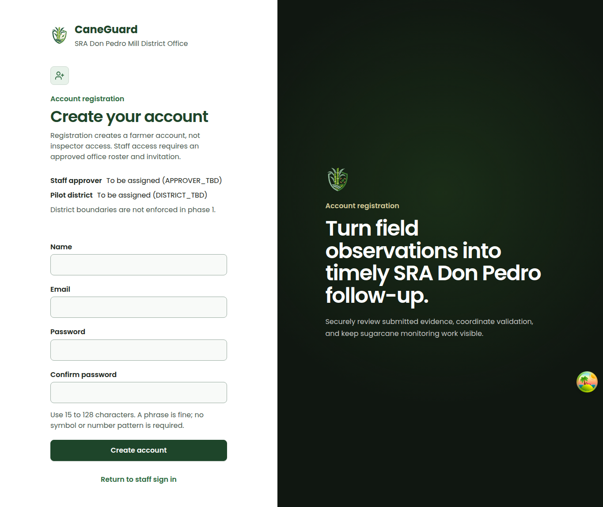
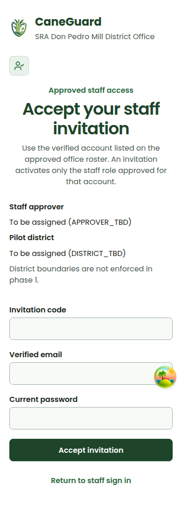

# ADR-002 phase-1 acceptance proof

Recorded on 2026-10-04 in the isolated implementation worktree. All accounts/references used by automated tests are synthetic; mail is faked. No production roster, migration, deployment or weekly-report email was exercised.

## Required demonstrations

| Requirement | Concrete evidence | Observed outcome |
|---|---|---|
| Sign-up grants no inspector abilities | `StaffProvisioningTest::test_signup_and_email_verification_never_grant_inspector_authority`; existing `AuthSecurityTest` registration regression | Forged role/abilities/certification/district ignored; created role is `farmer`. After real signed email verification, no staff certification; office login denied. Real issued farmer PAT has an empty ability array; official upload returns 403 and creates no case. |
| Uncertified account denied restricted access | `test_uncertified_and_farmer_sessions_and_wildcard_tokens_cannot_access_restricted_records`; `test_uncertified_staff_cannot_sign_in_to_staff_clients_or_receive_inspector_tokens` | Farmer, unclassified reporter/reviewer/admin, unknown and disabled accounts denied via both simulated cookie sessions and real wildcard PATs. Covered list/detail/images/validation photos/history/export/documents/map/analytics/dashboard/status v1/v2/v3/assignments/notifications/uploads v1/v2/review/handoff writes. No review/handoff mutation; no staff login/token issuance. |
| Roster-approved provisioning succeeds | `test_roster_approved_invitation_certifies_exact_role_and_revokes_previous_authentication`; `test_trusted_roster_command_bootstraps_only_configured_verified_identity_and_preserves_history` | Named configured provisioner plus approved synthetic roster entry issues one-use invitation. Recipient's verified email/password/token certifies exactly the stored inspector role, not the forged admin role. Old token/session removed; inspector re-login yields report abilities and status access. Historical reporter ID retained. Trusted roster bootstrap succeeds only after provisioner configuration. |
| Controlled invitations/default-deny administration | Other `StaffProvisioningTest` invitation, demotion and CORS regressions | Generic admin, self-invite, wrong password/recipient, missing delegation, expired/reissued/email-changed/removed-staff links denied. Consumed link replay denied. Direct staff promotion through old role API denied. Password step-up retained; credentialed cross-origin acceptance preflight supported. |
| Placeholders visible in UI and configuration | `api/.env.example`, `api/config/caneguard.php`, public configuration DTO tests, `AuthPages.test.tsx`, `AccessConfiguration.test.tsx`, screenshots below | `APPROVER_TBD` and `DISTRICT_TBD` both shown as **To be assigned**. Configuration failure shows an honest error/retry, not fabricated placeholder confirmation. Configured district displays without asserting district enforcement. |
| No anonymous signed restricted-data access | `test_signed_retired_consult_links_never_reopen_anonymous_json_or_photos`; existing expert-retirement suite | Signed current image URL without a session returns 401. Removed consult JSON/photo URLs stay 404 with legacy-looking signatures. Retirement is preserved, not reversed to an anonymous or staff-only consult workflow. |
| Existing data/evidence kept, unclassified authority frozen | `StaffCertificationMigrationMySqlTest` populated-schema upgrade; certification/history test; `DemoUserSeederTest` identity-preservation regression | MySQL upgrade retains complete persisted case attributes/evidence path, account role/password/UUID and legacy token. New certification fields remain null, and the wildcard legacy token is denied. Explicit approved certification restores inspector operation. Reseeding preserves existing identities/credentials/verification/certification and cannot itself certify staff. |

## Actual automated verification

- **PASS** `npm run check:web`: lint, typecheck, production TypeScript/Vite build, web tests, source-safety/design-spine/security/workflow validators. **66 suites / 428 tests passed**; two pre-existing live seeded-API tests skipped because no live seeded-API token was supplied (`src/data/api/seeded-data-contract.test.ts`). The build reports its existing large-chunk advisory, not a failure.
- **PASS** `npm run check:api` during the validation round; final post-review equivalent commands `cd api && vendor/bin/phpunit && vendor/bin/pint --test`: **351 tests / 16,958 assertions**, formatter clean.
- **PASS** MySQL migration/schema/security/demo suite: `vendor/bin/phpunit -c phpunit.mysql.xml`: **10 tests / 490 assertions**.
- **PASS** Actual MySQL affected auth/provisioning feature suites: `vendor/bin/phpunit -c phpunit.mysql.xml tests/Feature/StaffProvisioningTest.php tests/Feature/AuthSecurityTest.php`: **32 tests / 475 assertions**.
- MySQL commands used existing authorized development credential variables without printing their values, against the newly allocated `firstmate_cg_adr002_p1_20261004_9` database only. No production/unauthorized database was touched.
- **PASS** Impeccable static detector on changed auth UI: `[]` findings.
- **PASS** `git diff --check`.
- **PASS** required `graphify update .` and `npm run graphify:validate`. Broad generated graph/relabel/backup drift was inspected and is intentionally left unstaged; it is not part of the access implementation.
- No no-mistakes pipeline was invoked. No dependency changes, production deployment, merge or force-push was performed.

## Bounded live UI proof

Used the isolated `chrome-devtools-axi` session `cg-adr002-p1-9`, local task-owned Web/API servers on ports 5189/8099 and real API configuration responses. Captured both changed surfaces at desktop **1365 × 900** and mobile **390 × 844** in one inspection round; mobile document width was exactly 390px on both routes (no horizontal overflow). Fields are blank; screenshots contain no credentials or invitation secrets. Browser session and task-owned servers were stopped afterward.

This proves real rendering and placeholder/configuration wiring. The staff authentication/provisioning security behavior above is proven by Laravel integration tests with real issued PATs and simulated cookie authentication, **not claimed as a full live-browser staff-onboarding journey**. Office-specific approvals and mail delivery remain operational inputs.

### Registration: no inspector promise

[Desktop registration](registration-desktop.png) · [Mobile registration](registration-mobile.png)

### Staff invitation: controlled activation

[Desktop invitation](invitation-desktop.png) · [Mobile invitation](invitation-mobile.png)

## Review and limits

Change-focused in-thread security/data review checked every phase-1 acceptance requirement, server-side role/certification gates, cookie and PAT denials, invitation hashing/expiry/replay/recipient binding/delegation rechecks, user-before-invitation lock order, transactional revocation/audit, additive migration and seeder preservation. No actionable findings remain after corrections and regression checks.

**Not implemented or validated as complete:** anonymous farmer flow; farmer mobile UI/history; district boundaries/rollout gating; encrypted private/offline storage or finite token/offline policy; weekly approval/send/email workflow; production roster certification, secure-cookie rollout configuration, production mail delivery or deployment. See [operating notes](../../adr002-phase1-staff-access.md) before any rollout.
